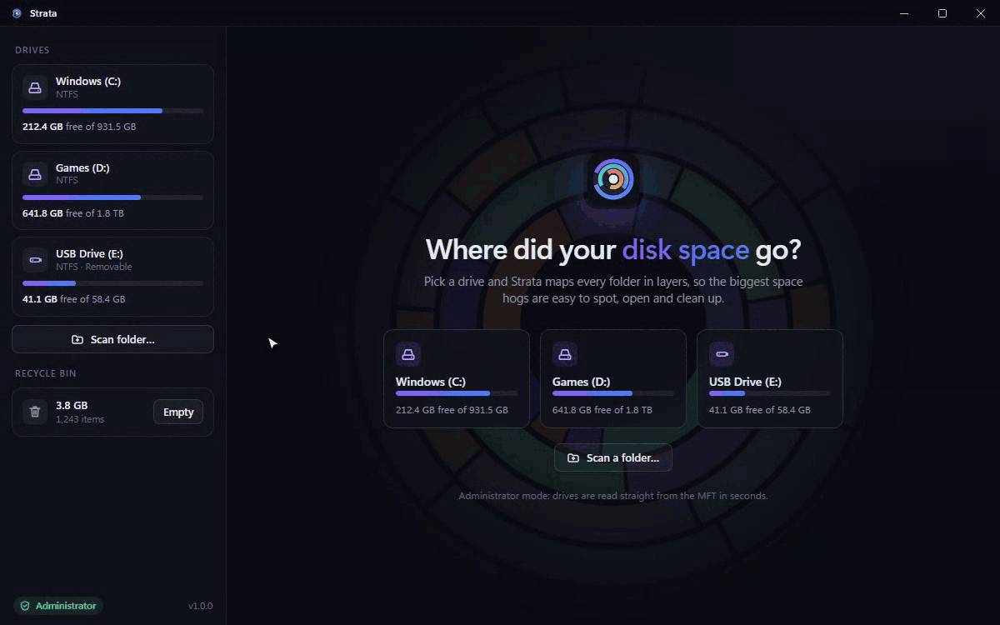
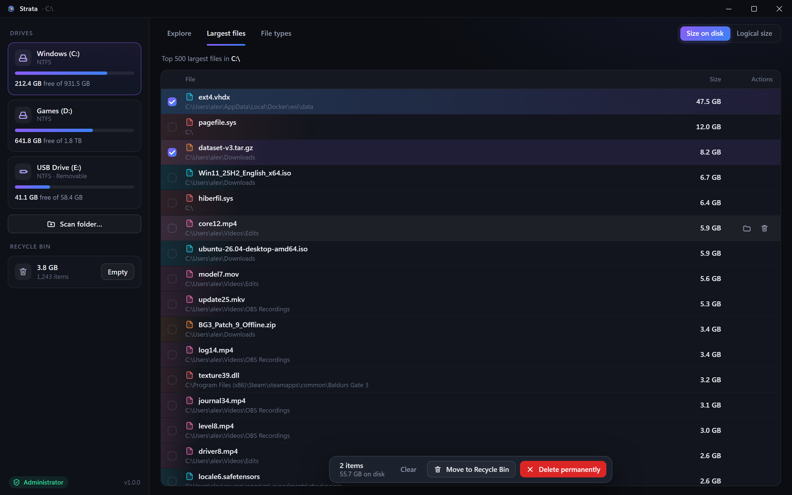
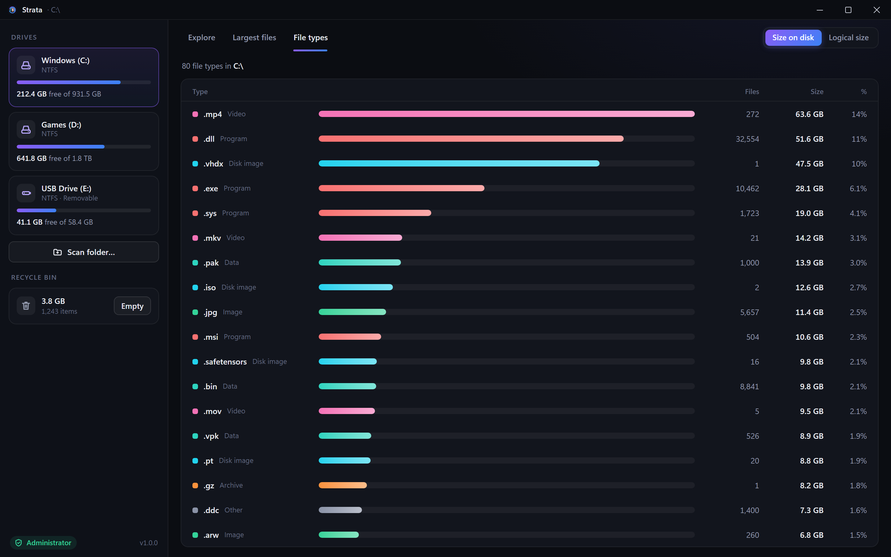

<div align="center">


# Strata

**See where your disk space went. In seconds.**

A fast, open-source disk space analyzer for Windows. It reads the NTFS Master File Table directly,
maps millions of files almost instantly, and lets you safely clean up what you no longer need.

[](https://github.com/Kasempiternal/strata/releases/latest)
&nbsp;
[](https://github.com/Kasempiternal/strata/actions/workflows/ci.yml)
&nbsp;
[](LICENSE)

[**Website**](https://kasempiternal.github.io/strata/) · [**Download**](https://github.com/Kasempiternal/strata/releases/latest) · [How it works](docs/ARCHITECTURE.md) · [Changelog](CHANGELOG.md)



</div>

## Why Strata

| | |
|---|---|
| ⚡ **Very fast** | A 1.8 TB drive with 3.5 million files maps in **about 3 seconds**. Strata reads the NTFS Master File Table directly with parallel, unbuffered I/O instead of opening every folder. |
| 🎯 **Easy to read** | An interactive sunburst shows where the space is at a glance. Click a slice to drill in, click the centre to go back. The sortable list beside it stays in sync. |
| 🧹 **Safe cleanup** | Deleted items go to the Recycle Bin by default, and every delete needs confirmation. Windows, Program Files, profile roots and NTFS system files are always protected. |
| 🔍 **Find the culprits** | **Largest files** across a whole drive, and a **File types** breakdown (videos, VM disks, game installs…) for any folder. |
| 📏 **Real numbers** | Toggle between *size on disk* and *logical size*. Compression, sparse files (WSL/Docker disks), alternate data streams and OneDrive placeholders are counted correctly. |
| 🔒 **Private** | No network access and no telemetry. Your file list never leaves your PC. |
| 🪶 **Tiny** | The installer is about 1.5 MB. Native Rust engine, no Electron. |

<table>
<tr>
<td></td>
<td></td>
</tr>
<tr>
<td align="center"><b>Largest files</b>: select and clean up in bulk</td>
<td align="center"><b>File types</b>: see what kind of data fills a folder</td>
</tr>
</table>

## Install

1. Download **`Strata_x.y.z_x64-setup.exe`** from the [latest release](https://github.com/Kasempiternal/strata/releases/latest).
2. Run it. No admin rights are needed to install.
   > The installer isn't code-signed yet, so Windows SmartScreen may say *"Windows protected your PC"*.
   > Click **More info → Run anyway**.
3. Open Strata and click a drive.

**Requirements:** Windows 10 or 11, x64. WebView2 is preinstalled on Windows 11, and the installer fetches it on Windows 10 if needed.

### Administrator mode vs standard mode

| | Administrator mode | Standard mode |
|---|---|---|
| How | Reads the NTFS Master File Table directly | Walks folders in parallel |
| Speed | Seconds for a whole drive | Seconds to minutes, depending on file count |
| Coverage | Everything, including system folders | Skips folders your account can't read |
| Works on | NTFS drives | Any drive, folder or network share |

Click **Restart as admin** in the sidebar to switch to administrator mode at any time.

## Benchmarks

Full scan, Windows 11, Ryzen 7 3800X:

| Drive | Data | Files | Strata (MFT) | Strata (walk) |
|---|---|---|---|---|
| WD SN770 2 TB NVMe | 1.8 TB | 3.5 M | **3.0 s** | – |
| WD Blue 3D NAND 1 TB SATA | 764 GB | 434 k | **2.4 s** | 3.1 s |

Reproduce with `cargo run --release --example bench -- C:\` in an elevated terminal.

## Keyboard shortcuts

| Key | Action |
|---|---|
| `Enter` / double-click | Open folder |
| `Backspace` | Go up |
| `Delete` | Move selected items to the Recycle Bin |
| `Shift + Delete` | Delete selected items permanently (with confirmation) |
| Right-click | Open, Reveal in Explorer, Copy path, Delete |

## Build from source

```powershell
git clone https://github.com/Kasempiternal/strata
cd strata
npm install
npx tauri build   # installer → src-tauri/target/release/bundle/nsis/
```

You need Rust (stable, MSVC), Node.js 20+ and the Visual Studio C++ Build Tools. See [CONTRIBUTING.md](CONTRIBUTING.md) for details,
and [docs/ARCHITECTURE.md](docs/ARCHITECTURE.md) for how the MFT engine works.

The engine also ships two command-line tools for power users (run elevated):

```powershell
cargo run --release --example du -- "C:\Users\me" --depth 3        # size tree
cargo run --release --example finddirs -- "node_modules,target" C:\  # find build artifacts
```

## FAQ

**Is it safe to run as administrator?**
Strata only reads until you delete something, and every delete needs your confirmation. It has no network code at all. See [SECURITY.md](SECURITY.md).

**Why does the Recycle Bin option not free space?**
Recycled files still take up space until you empty the bin. Use **Empty** in the sidebar, or choose *Delete permanently*.

**Why is "size on disk" different from "logical size"?**
Size on disk counts the clusters a file actually occupies. Compressed and sparse files (like WSL or Docker `.vhdx` disks) can use much less than their logical size, and tiny files can use none at all because they're stored inside the MFT.

## License

[MIT](LICENSE) © 2026 Kasempiternal
